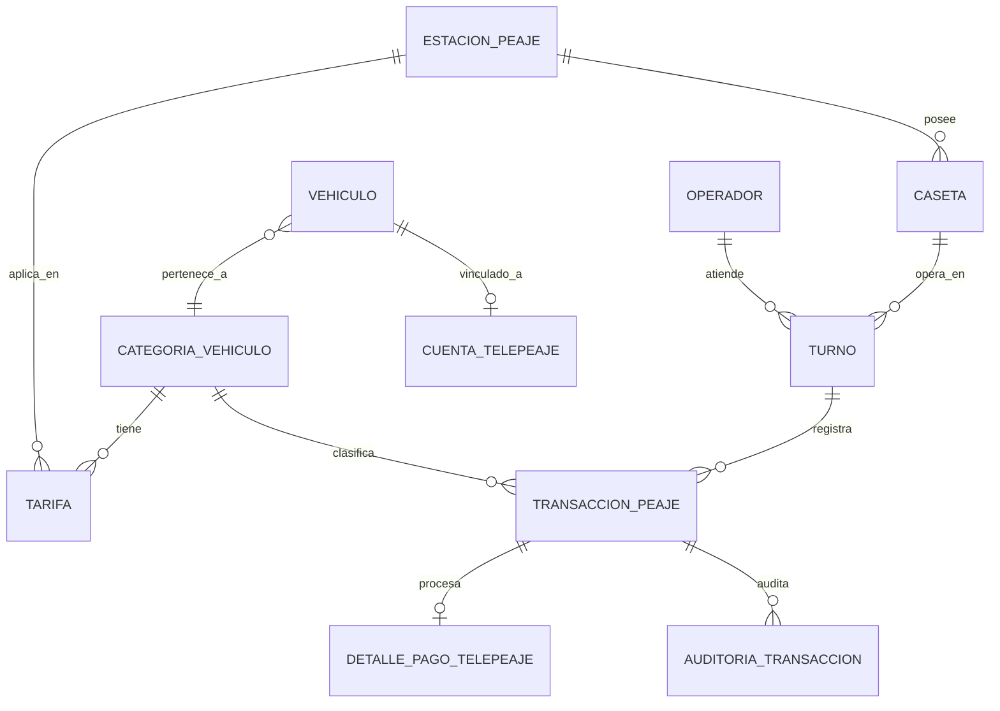

<div align="center">

<!-- ═══════════════════ HEADER ANIMADO ═══════════════════ -->


<br>

<a href="https://git.io/typing-svg">
  
</a>

<br/><br/>

<!-- ═══════════════════ BADGES BAR ═══════════════════ -->
[](https://www.postgresql.org/)
[](https://learn.microsoft.com/dotnet/csharp/)
[](https://dotnet.microsoft.com/)
[](https://www.typescriptlang.org/)
[](https://visualstudio.microsoft.com/)
[](https://code.visualstudio.com/)
[](https://git-scm.com/)
[](https://github.com/ManuelAmell/PeajeSys)

<br>

<a id="top"></a>

**📑 Tabla de Contenidos**
<br>
[📌 Descripción](#-descripci%C3%B3n-del-proyecto) &nbsp;·&nbsp;
[🚀 Características](#-caracter%C3%ADsticas-principales) &nbsp;·&nbsp;
[🛠️ Stack Tecnológico](#%EF%B8%8F-stack-tecnol%C3%B3gico) &nbsp;·&nbsp;
[🏛️ Arquitectura & Modelo](#%EF%B8%8F-arquitectura-del-sistema-y-base-de-datos) &nbsp;·&nbsp;
[👥 Equipo y Roles](#-distribuci%C3%B3n-del-equipo-y-responsabilidades) &nbsp;·&nbsp;
[⚙️ Instalación](#%EF%B8%8F-instalaci%C3%B3n-y-ejecuci%C3%B3n-local) &nbsp;·&nbsp;
[🗺️ Roadmap](#%EF%B8%8F-roadmap-y-entregables-acad%C3%A9micos) &nbsp;·&nbsp;
[📄 Licencia](#-licencia)

<br>

</div>

---

## 📌 Descripción del Proyecto

**PeajeSys** es una solución integral de software orientada al control, liquidación y auditoría de estaciones de peaje vehicular en redes viales y concesiones. Su propósito fundamental es optimizar la fluidez del tránsito vehicular, mitigar discrepancias en la recaudación de fondos y proveer trazabilidad de cada evento de cobro y paso vehicular mediante una base de datos relacional robusta.

> **🏛️ Contexto Académico:**
> Este sistema es diseñado e implementado para la asignatura **Base de Datos**, aplicando principios de modelado entidad-relación (MER), normalización (3FN/BCNF), integridad transaccional (ACID), procedimientos almacenados, triggers de auditoría e indexación eficiente sobre el motor relacional **PostgreSQL**.

---

## 🚀 Características Principales

<table>
  <tr>
    <td width="50%" valign="top">
      <h3>🚗 Clasificación Vehicular Dinámica</h3>
      <ul>
        <li>Parametrización por categorías oficiales (Categorías I a VII: automóviles, buses, camiones según número de ejes).</li>
        <li>Cálculo automático de tarifas vigentes por estación y sentido de vía.</li>
      </ul>
    </td>
    <td width="50%" valign="top">
      <h3>💳 Cobro Multimodal y Telepeaje</h3>
      <ul>
        <li><b>Cobro en Efectivo:</b> Registro de recaudación manual en taquilla.</li>
        <li><b>Telepeaje (RFID / TAG):</b> Validación de cuentas, débito automático en tiempo real y verificación de saldo.</li>
      </ul>
    </td>
  </tr>
  <tr>
    <td width="50%" valign="top">
      <h3>⏱️ Control de Turnos y Casetas</h3>
      <ul>
        <li>Apertura y cierre de turnos con arqueo de caja detallado.</li>
        <li>Asignación de operadores a casetas de cobro específicas.</li>
        <li>Detección de descuadres e inconsistencias de recaudación.</li>
      </ul>
    </td>
    <td width="50%" valign="top">
      <h3>📊 Auditoría y Analítica de Tránsito</h3>
      <ul>
        <li>Trazabilidad inmutable de todas las transacciones mediante triggers en PostgreSQL.</li>
        <li>Reportes de aforo vehicular, horas pico y recaudación acumulada por período.</li>
        <li>Gestión de excepciones (vehículos exentos de emergencia, evasiones).</li>
      </ul>
    </td>
  </tr>
</table>

---

## 🛠️ Stack Tecnológico

<div align="center">

| Capa / Componente | Tecnología | Propósito y Función |
| :--- | :--- | :--- |
| **Base de Datos** |  **PostgreSQL** | Motor relacional, integridad referencial, transacciones ACID, triggers y procedimientos PL/pgSQL. |
| **Backend API** |   **C# + .NET** | API RESTful modular, arquitectura en capas, Entity Framework Core / Dapper y reglas de negocio. |
| **Frontend UI** |  **TypeScript** | Aplicación web interactiva, tipado estricto, panel de operador en taquilla y dashboard administrativo. |
| **Control de Versiones** |   **Git & GitHub** | Gestión del ciclo de vida del código, ramas de trabajo (GitFlow) e integración de entregables. |
| **Entornos (IDEs)** |   **VS Community + VS Code** | Desarrollo, compilación y depuración optimizada tanto para C#/.NET como TypeScript. |

</div>

---

## 🏛️ Arquitectura del Sistema y Base de Datos

```mermaid
flowchart TD
    subgraph Frontend ["🖥️ Frontend (TypeScript / Visual Studio Code)"]
        UI_Taquilla["Taquilla / Operador"]
        UI_Admin["Dashboard Administrativo"]
        UI_Telepeaje["Portal de Usuarios & TAGs"]
    end

    subgraph Backend ["⚡ Backend API (C# .NET / Visual Studio Community)"]
        API_Gateway["Controllers / REST API"]
        BLL_Transacciones["Servicio de Transacciones & Cobro"]
        BLL_Telepeaje["Servicio de Telepeaje & Saldos"]
        BLL_Turnos["Servicio de Turnos & Arqueo"]
        DAL["Data Access Layer (EF Core / Dapper)"]
    end

    subgraph Database ["🐘 Base de Datos Relacional (PostgreSQL)"]
        DB_Core[(Tablas Principales: Estaciones, Casetas, Categorias, Tarifas)]
        DB_Tx[(Transacciones de Peaje & Cuentas TAG)]
        DB_Audit[(Triggers & Tablas de Auditoría Inmutable)]
        DB_Views[(Vistas Materializadas de Reportes)]
    end

    Frontend -->|HTTP / JSON (REST)| API_Gateway
    API_Gateway --> BLL_Transacciones & BLL_Telepeaje & BLL_Turnos
    BLL_Transacciones & BLL_Telepeaje & BLL_Turnos --> DAL
    DAL -->|Conexión Segura Npgsql| Database
```

### 🗃️ Modelo de Entidades Principales



---

## 👥 Distribución del Equipo y Responsabilidades

<div align="center">

| Miembro | Rol Principal | Áreas de Enfoque y Responsabilidad |
| :--- | :--- | :--- |
| **👨‍💻 Alex** | **Backend Developer** | Arquitectura de servicios C#/.NET, diseño de endpoints REST, seguridad y lógica de negocio. |
| **👨‍💻 Samuel** | **Backend Developer** | Lógica de transacciones, validación de turnos/arqueos e integración de la capa de acceso a datos. |
| **👨‍💻 Manuel** | **Database & Full-Stack** | Modelado DDL/DML en PostgreSQL, procedimientos/triggers, optimización e integración backend/frontend. |
| **👨‍💻 Camilo** | **Frontend Developer** | Interfaz web en TypeScript, componentes visuales, consumo de APIs y experiencia de usuario (UX). |

</div>

---

## 📂 Estructura del Repositorio

```text
PeajeSys/
├── 📁 .github/             # Plantillas de issues, workflows y configuración
├── 📁 database/            # Scripts de Base de Datos PostgreSQL
│   ├── 📁 ddl/             # Creación de tablas, llaves y restricciones
│   ├── 📁 dml/             # Datos iniciales (categorías, tarifas, usuarios)
│   ├── 📁 triggers/        # Triggers de auditoría y cálculo de saldos
│   └── 📁 procedures/      # Procedimientos almacenados y funciones PL/pgSQL
├── 📁 backend/             # Solución Web API en C# + .NET (Visual Studio)
│   ├── 📁 PeajeSys.Api/    # Controladores, Middleware y Configuración
│   ├── 📁 PeajeSys.Core/   # Entidades de dominio e interfaces
│   └── 📁 PeajeSys.Data/   # DbContext, Repositorios y Mapeos
├── 📁 frontend/            # Aplicación Web en TypeScript (VS Code)
│   ├── 📁 src/             # Componentes, vistas, servicios y tipados
│   └── 📁 public/          # Assets, iconos y estilos globales
├── 📁 docs/                # Diagramas MER, diccionario de datos y especificaciones
├── 📄 .gitignore           # Exclusiones de binarios, dependencias y credenciales
└── 📄 README.md            # Documentación general del proyecto
```

---

## ⚙️ Instalación y Ejecución Local

### 1️⃣ Prerrequisitos
- [Git](https://git-scm.com/) (v2.30 o superior)
- [PostgreSQL](https://www.postgresql.org/download/) (v15 o superior)
- [.NET SDK](https://dotnet.microsoft.com/download) (v8.0 o superior)
- [Node.js & npm](https://nodejs.org/) (v18 o superior)
- IDEs: [Visual Studio Community 2022](https://visualstudio.microsoft.com/) / [Visual Studio Code](https://code.visualstudio.com/)

---

### 2️⃣ Clonar el Repositorio
```bash
git clone https://github.com/ManuelAmell/PeajeSys.git
cd PeajeSys
```

---

### 3️⃣ Configuración de la Base de Datos (PostgreSQL)
1. Iniciar el servicio de PostgreSQL (vía `pgAdmin` o terminal `psql`).
2. Crear la base de datos `peajesys_db`:
   ```sql
   CREATE DATABASE peajesys_db;
   ```
3. Ejecutar los scripts DDL y DML en orden:
   ```bash
   psql -U postgres -d peajesys_db -f database/ddl/01_init_schema.sql
   psql -U postgres -d peajesys_db -f database/dml/02_initial_data.sql
   psql -U postgres -d peajesys_db -f database/triggers/03_audit_triggers.sql
   ```

---

### 4️⃣ Ejecución del Backend (C# .NET)
```bash
cd backend/PeajeSys.Api
dotnet restore
dotnet build
dotnet run
```
> La API estará disponible por defecto en `https://localhost:7001` (con documentación Swagger en `/swagger`).

---

### 5️⃣ Ejecución del Frontend (TypeScript)
```bash
cd frontend
npm install
npm run dev
```
> La interfaz web estará disponible por defecto en `http://localhost:5173`.

---

## 🗺️ Roadmap y Entregables Académicos

- [x] **Fase 0:** Definición del alcance, especificación de requisitos y estructura del repositorio.
- [ ] **Fase 1:** Modelado Conceptual (MER) y Lógico (Diagrama Relacional 3FN).
- [ ] **Fase 2:** Implementación DDL, DML, Triggers de Auditoría y Procedimientos en PostgreSQL.
- [ ] **Fase 3:** Desarrollo de la API REST en C# .NET y conexión con la base de datos.
- [ ] **Fase 4:** Construcción del Frontend en TypeScript (Módulo Taquilla & Módulo Admin).
- [ ] **Fase 5:** Pruebas de concurrencia de transacciones, validación ACID y entrega final.

---

## 📄 Licencia

Este proyecto se distribuye bajo fines académicos y formativos para la asignatura **Base de Datos** de la **Universidad de Cartagena**.

---

<div align="center">

<a href="#top">
  
</a>

<br><br>


</div>
