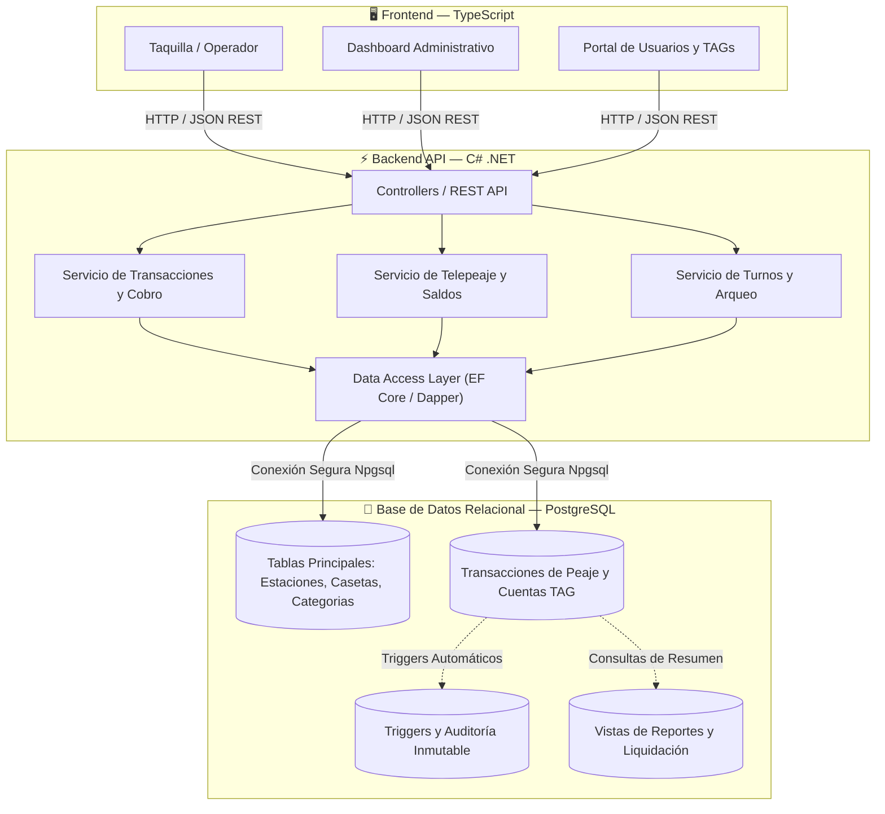
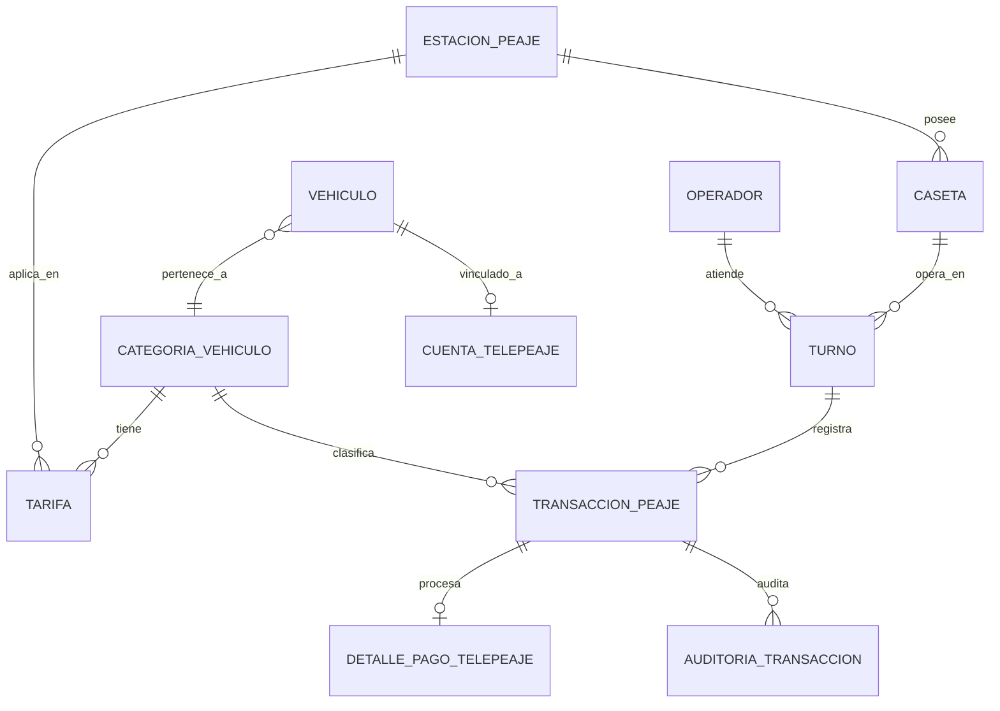

<div align="center">

<!-- ═══════════════════ HEADER ANIMADO ═══════════════════ -->


<br>

<a href="https://git.io/typing-svg">
  
</a>

<br/><br/>

<!-- ═══════════════════ BADGES BAR ═══════════════════ -->
[](https://github.com/ManuelAmell/PeajeSys/actions/workflows/ci.yml)
[](https://www.postgresql.org/)
[](https://learn.microsoft.com/dotnet/csharp/)
[](https://dotnet.microsoft.com/)
[](https://www.typescriptlang.org/)
[](https://visualstudio.microsoft.com/)
[](https://code.visualstudio.com/)
[](https://git-scm.com/)
[](https://github.com/ManuelAmell/PeajeSys)

<br>

<a id="top"></a>

**📑 Tabla de Contenidos**
<br>
[📌 Descripción](#-descripci%C3%B3n-del-proyecto) &nbsp;·&nbsp;
[🚀 Características](#-caracter%C3%ADsticas-principales) &nbsp;·&nbsp;
[⚡ Inicio rápido](#-inicio-r%C3%A1pido) &nbsp;·&nbsp;
[🛠️ Stack Tecnológico](#%EF%B8%8F-stack-tecnol%C3%B3gico) &nbsp;·&nbsp;
[🏛️ Arquitectura & Modelo](#%EF%B8%8F-arquitectura-del-sistema-y-base-de-datos) &nbsp;·&nbsp;
[👥 Equipo y Roles](#-distribuci%C3%B3n-del-equipo-y-responsabilidades) &nbsp;·&nbsp;
[⚙️ Instalación](#%EF%B8%8F-instalaci%C3%B3n-y-ejecuci%C3%B3n-local) &nbsp;·&nbsp;
[🗺️ Roadmap](#%EF%B8%8F-roadmap-y-entregables-acad%C3%A9micos) &nbsp;·&nbsp;
[📄 Licencia](#-licencia)

<br>

</div>

---

## 📌 Descripción del Proyecto

**PeajeSys** es una solución integral de software orientada al control, liquidación y auditoría de estaciones de peaje vehicular en redes viales y concesiones. Su propósito fundamental es optimizar la fluidez del tránsito vehicular, mitigar discrepancias en la recaudación de fondos y proveer trazabilidad de cada evento de cobro y paso vehicular mediante una base de datos relacional robusta.

> **🏛️ Contexto Académico:**
> Este sistema es diseñado e implementado para la asignatura **Base de Datos**, aplicando principios de modelado entidad-relación (MER), normalización (3FN/BCNF), integridad transaccional (ACID), procedimientos almacenados, triggers de auditoría e indexación eficiente sobre el motor relacional **PostgreSQL**.

---

## 🚀 Características Principales

<table>
  <tr>
    <td width="50%" valign="top">
      <h3>🚗 Clasificación Vehicular Dinámica</h3>
      <ul>
        <li>Parametrización por categorías oficiales (Categorías I a VII: automóviles, buses, camiones según número de ejes).</li>
        <li>Cálculo automático de tarifas vigentes por estación y sentido de vía.</li>
      </ul>
    </td>
    <td width="50%" valign="top">
      <h3>💳 Cobro Multimodal y Telepeaje</h3>
      <ul>
        <li><b>Cobro en Efectivo:</b> Registro de recaudación manual en taquilla.</li>
        <li><b>Telepeaje (RFID / TAG):</b> Validación de cuentas, débito automático en tiempo real y verificación de saldo.</li>
      </ul>
    </td>
  </tr>
  <tr>
    <td width="50%" valign="top">
      <h3>⏱️ Control de Turnos y Casetas</h3>
      <ul>
        <li>Apertura y cierre de turnos con arqueo de caja detallado.</li>
        <li>Asignación de operadores a casetas de cobro específicas.</li>
        <li>Detección de descuadres e inconsistencias de recaudación.</li>
      </ul>
    </td>
    <td width="50%" valign="top">
      <h3>📊 Auditoría y Analítica de Tránsito</h3>
      <ul>
        <li>Trazabilidad inmutable de todas las transacciones mediante triggers en PostgreSQL.</li>
        <li>Reportes de aforo vehicular, horas pico y recaudación acumulada por período.</li>
        <li>Gestión de excepciones (vehículos exentos de emergencia, evasiones).</li>
      </ul>
    </td>
  </tr>
</table>

---

## ⚡ Inicio rápido

Pensado para clonar y ejecutar en **Windows (PowerShell)** y **Linux/macOS (bash)** sin crear archivos de configuración. La integración continua en GitHub Actions ejecuta las mismas pruebas y compilación en Windows (`windows-latest`) y en Linux (`ubuntu-latest`).

### Requisitos

- [Git](https://git-scm.com/).
- [Docker Desktop](https://www.docker.com/products/docker-desktop/) (Windows/macOS) o Docker Engine con el plugin `docker compose` (Linux). Se usa solo para la base de datos; hay una alternativa sin Docker más abajo.
- [.NET SDK](https://dotnet.microsoft.com/download) 8 o superior. El proyecto apunta a `net8.0` y se compila con cualquier SDK 8 o superior (`RollForward=Major`).
- [Node.js](https://nodejs.org/) 20 o superior y pnpm 10.33.2, que se activa con `corepack enable` (en Windows, desde una terminal con permisos de administrador si falla).

### Pasos

**bash (Linux / macOS / Git Bash)**

```bash
git clone https://github.com/ManuelAmell/PeajeSys.git
cd PeajeSys
corepack enable
pnpm install        # instala la raíz y, con postinstall, también el frontend
pnpm db             # levanta PostgreSQL 16 en Docker (puerto 5432)
docker compose ps   # repetir hasta que el servicio db diga "healthy" (la primera vez tarda)
pnpm dev            # API en 5080 + web en 5180
```

**PowerShell (Windows)**

```powershell
git clone https://github.com/ManuelAmell/PeajeSys.git
cd PeajeSys
corepack enable
pnpm install        # instala la raíz y, con postinstall, también el frontend
pnpm db             # levanta PostgreSQL 16 en Docker (puerto 5432)
docker compose ps   # repetir hasta que el servicio db diga "healthy" (la primera vez tarda)
pnpm dev            # API en 5080 + web en 5180
```

En PowerShell 5 no existe `&&`: ejecuta cada comando en su propia línea (o sepáralos con `;`).

Cuando `docker compose ps` muestre `healthy`, abre <http://localhost:5180> e inicia sesión con un [usuario de prueba](#-usuarios-de-prueba), por ejemplo `SUP-001` / `Samuel2026*`. La API tiene Swagger en <http://localhost:5080/swagger> y health check en <http://localhost:5080/health>.

Para detener todo: `Ctrl+C` en la terminal de `pnpm dev` y `docker compose stop` (o `docker compose down` para quitar el contenedor; los datos se conservan en un volumen hasta `docker compose down -v`).

### Sin Docker (PostgreSQL local)

Instala PostgreSQL 14 o superior, crea la base `peajesys_db` y carga `database/00_Master_PeajeSys.sql` con `psql`: los comandos exactos, para bash y PowerShell, están en [database/README.md](database/README.md). La API espera `localhost:5432`, base `peajesys_db`, usuario y contraseña `postgres`/`postgres`; si los tuyos difieren, define `ConnectionStrings__DefaultConnection` como se muestra en la solución de problemas. Después usa `pnpm dev` igual que arriba (no ejecutes `pnpm db`).

### Modo sin backend

Para ver la interfaz sin API ni base de datos (datos simulados con MSW):

```bash
pnpm install
pnpm dev:mocks      # http://localhost:5180
```

En este modo el login acepta cualquier contraseña no vacía (ver [limitaciones conocidas](docs/limitaciones-conocidas.md)).

### Otros comandos de la raíz

| Comando | Qué hace |
|---|---|
| `pnpm dev` | API (5080) + web (5180) contra la base real |
| `pnpm dev:mocks` | Solo la web con datos simulados |
| `pnpm api` / `pnpm web` | Solo la API / solo la web |
| `pnpm db` / `pnpm db:reset` | Levanta la base / la reinicia desde cero (borra los datos) |
| `pnpm test` | Pruebas del backend (`dotnet test`) y del frontend (Vitest) |

Las pruebas E2E se ejecutan desde `frontend/`: `pnpm e2e` (ver [frontend/README.md](frontend/README.md)). Para verificar el proyecto en un Windows limpio hay una [checklist](docs/verificacion-windows.md).

### Solución de problemas

**El puerto 5432 está ocupado** (otro PostgreSQL local o contenedor). Usa otro puerto para Docker y dile a la API cuál es:

```bash
# bash
PEAJESYS_DB_PORT=5433 pnpm db
export ConnectionStrings__DefaultConnection="Host=localhost;Port=5433;Database=peajesys_db;Username=postgres;Password=postgres"
pnpm dev
```

```powershell
# PowerShell (las variables valen solo para esa ventana)
$env:PEAJESYS_DB_PORT = "5433"
pnpm db
$env:ConnectionStrings__DefaultConnection = "Host=localhost;Port=5433;Database=peajesys_db;Username=postgres;Password=postgres"
pnpm dev
```

Si ya creaste el contenedor con otro puerto, usa siempre el mismo valor de `PEAJESYS_DB_PORT` en los comandos `docker compose` (incluido `docker compose down -v`).

**Los puertos 5080 o 5180 están ocupados.** Cierra el proceso que los usa. Averigua cuál es:

```bash
# bash
ss -ltnp | grep -E ':(5080|5180)'
```

```powershell
# PowerShell
netstat -ano | findstr ":5080"
netstat -ano | findstr ":5180"
# el último número es el PID: Stop-Process -Id <PID>
```

El frontend usa `--strictPort`: si el 5180 está ocupado, falla en lugar de cambiar de puerto.

**Reiniciar la base de datos desde cero** (borra los datos y vuelve a cargar el script maestro): `pnpm db:reset`. En PowerShell 5 también funciona, porque el `&&` lo ejecuta pnpm y no la shell. Después espera de nuevo a `healthy`. Si `docker compose ps` muestra `exited`, mira `docker compose logs db`.

**Los E2E fallan por falta de Chromium.** Desde `frontend/`: `pnpm exec playwright install chromium` y repite `pnpm e2e`.

**`dotnet` no encuentra el SDK** (`No .NET SDKs were found`, o `dotnet` no se reconoce). Instala el SDK 8 o superior (no basta el runtime), abre una terminal nueva y comprueba `dotnet --list-sdks`. Si hay varias versiones y una `global.json` ajena fuerza otra, ejecuta el comando desde la carpeta del repo.

**La API arranca pero el login falla con error de conexión.** La base no está lista o no es la esperada: revisa `docker compose ps` y el puerto (ver el primer punto).

---

## 🛠️ Stack Tecnológico

<div align="center">

| Capa / Componente | Tecnología | Propósito y Función |
| :--- | :--- | :--- |
| **Base de Datos** |  **PostgreSQL** | Motor relacional, integridad referencial, transacciones ACID, triggers y procedimientos PL/pgSQL. |
| **Backend API** |   **C# + .NET** | API RESTful modular, arquitectura en capas, Entity Framework Core / Dapper y reglas de negocio. |
| **Frontend UI** |  **TypeScript** | Aplicación web interactiva, tipado estricto, panel de operador en taquilla y dashboard administrativo. |
| **Control de Versiones** |   **Git & GitHub** | Gestión del ciclo de vida del código, ramas de trabajo (GitFlow) e integración de entregables. |
| **Entornos (IDEs)** |   **VS Community + VS Code** | Desarrollo, compilación y depuración optimizada tanto para C#/.NET como TypeScript. |

</div>

---

## 🏛️ Arquitectura del Sistema y Base de Datos



### 🗃️ Modelo de Entidades Principales



---

## 👥 Distribución del Equipo y Responsabilidades

<div align="center">

| Miembro | Rol Principal | Áreas de Enfoque y Responsabilidad |
| :--- | :--- | :--- |
| **👨‍💻 Alex** | **Backend Developer** | Arquitectura de servicios C#/.NET, diseño de endpoints REST, seguridad y lógica de negocio. |
| **👨‍💻 Samuel** | **Backend Developer** | Lógica de transacciones, validación de turnos/arqueos e integración de la capa de acceso a datos. |
| **👨‍💻 Manuel** | **Database & Full-Stack** | Modelado DDL/DML en PostgreSQL, procedimientos/triggers, optimización e integración backend/frontend. |
| **👨‍💻 Camilo** | **Frontend Developer** | Interfaz web en TypeScript, componentes visuales, consumo de APIs y experiencia de usuario (UX). |

</div>

---

## 📂 Estructura del Repositorio

```text
PeajeSys/
├── 📁 database/            # PostgreSQL: scripts SQL y PL/pgSQL (ver database/README.md)
│   ├── 📄 00_Master_PeajeSys.sql  # Script maestro: reconstruye todo en limpio
│   ├── 📁 01_Modelado/     # Diccionario de datos y esquema E-R
│   ├── 📁 02_SQL/          # DDL, DML (datos), consultas y objetos (vistas, índice)
│   └── 📁 03_PLSQL/        # Funciones, procedimientos, triggers, proceso con cursor y matriz de pruebas
├── 📁 backend/             # Solución .NET (PeajeSys.sln, net8.0)
│   ├── 📁 PeajeSys.Api/    # Controladores, middlewares, servicios y Program.cs
│   ├── 📁 PeajeSys.Core/   # Entidades, DTOs, interfaces y excepciones de dominio
│   ├── 📁 PeajeSys.Data/   # DbContext (EF Core + Npgsql), mapeos y repositorios
│   ├── 📁 PeajeSys.Dominio/# Clases de dominio complementarias
│   └── 📁 PeajeSys.Tests/  # Pruebas xUnit
├── 📁 frontend/            # React + Vite + TypeScript (pnpm, MSW, Vitest, Playwright)
│   ├── 📁 src/             # Features, componentes, API tipada y mocks
│   ├── 📁 e2e/             # Pruebas E2E
│   └── 📁 scripts/         # Herramienta de capturas
├── 📁 docs/                # Arquitectura, contrato de la API, diseño, tareas y entregas
├── 📄 docker-compose.yml   # PostgreSQL 16 de desarrollo (carga el script maestro)
├── 📄 package.json         # Comandos de la raíz: pnpm dev, db, test...
├── 📄 pendientes.md        # Estado y pendientes del proyecto
└── 📄 README.md            # Este documento
```

---

## ⚙️ Ejecución por partes

La forma rápida está en [Inicio rápido](#-inicio-r%C3%A1pido). Si prefieres arrancar cada pieza por separado:

1. **Base de datos**: `pnpm db` (Docker) o `psql` con un PostgreSQL local, según [database/README.md](database/README.md).
2. **API** (.NET): `cd backend/PeajeSys.Api` y `dotnet run`. Arranca en Development, en `http://localhost:5080` (Swagger en `/swagger`, health en `/health`), sin configurar nada. Detalles, JWT y seguridad en [backend/README.md](backend/README.md).
3. **Frontend**: desde la raíz `pnpm web` (o `pnpm --dir frontend dev`), en `http://localhost:5180`. Detalles en [frontend/README.md](frontend/README.md).

Documentación adicional: [limitaciones conocidas](docs/limitaciones-conocidas.md), [verificación en Windows](docs/verificacion-windows.md) y [pendientes](pendientes.md).

---

## 🔑 Usuarios de prueba

Los usuarios del equipo existen de verdad en la base de datos (tabla `OPERADOR`) con su contraseña cifrada con BCrypt (`BCrypt.Net-Next`, coste 12). El login valida solo contra la base de datos: no hay usuarios ni contraseñas fijos en el código.

| Usuario | Nombre | Rol | Contraseña | Panel |
|---|---|---|---|---|
| `ADM-001` | Manuel Amell | ADMINISTRADOR | `Manuel2026*` | `/admin` |
| `SUP-001` | Samuel Otero | SUPERVISOR | `Samuel2026*` | `/supervisor` |
| `REC-001` | Alex Florez | RECAUDADOR | `Alex2026*` | `/operador` |
| `REC-002` | Camilo Guzmán | RECAUDADOR | `Camilo2026*` | `/operador` |

- Los cuatro se cargan con `database/02_SQL/02_DML_Datos_PeajeSys.sql` (y con el maestro `database/00_Master_PeajeSys.sql`), con su `password_hash`.
- `EMP-001` a `EMP-010` son datos históricos (dueños de turnos y transacciones) sin contraseña: no pueden iniciar sesión.
- En modo mocks (`pnpm dev:mocks`) el login acepta cualquier contraseña no vacía para estos usuarios.
- **Cambiar una contraseña**: crear el operador desde el panel de administración (la contraseña es obligatoria y se guarda cifrada), o generar un hash nuevo con BCrypt (coste 12) y guardarlo con `UPDATE OPERADOR SET password_hash = '<hash>' WHERE codigo_empleado = '<usuario>';`. Con pgcrypto: `SELECT crypt('NuevaClave', gen_salt('bf', 12));`. Si cambias la contraseña de un usuario del equipo, actualiza también esta tabla y el DML: una prueba automática (`UsuariosEquipoSqlTests`) los mantiene sincronizados.
- **Pruebas manuales del equipo**: la guía paso a paso por rol, con los resultados esperados y cómo reportar fallos, está en [docs/pruebas-manuales.md](docs/pruebas-manuales.md).

---

## 🗺️ Roadmap y Entregables Académicos

- [x] **Fase 0:** Definición del alcance, especificación de requisitos y estructura del repositorio.
- [ ] **Fase 1:** Modelado Conceptual (MER) y Lógico (Diagrama Relacional 3FN).
- [ ] **Fase 2:** Implementación DDL, DML, Triggers de Auditoría y Procedimientos en PostgreSQL.
- [ ] **Fase 3:** Desarrollo de la API REST en C# .NET y conexión con la base de datos.
- [ ] **Fase 4:** Construcción del Frontend en TypeScript (Módulo Taquilla & Módulo Admin).
- [ ] **Fase 5:** Pruebas de concurrencia de transacciones, validación ACID y entrega final.

---

## 📄 Licencia

Este proyecto se distribuye bajo fines académicos y formativos para la asignatura **Base de Datos** de la **Universidad de Cartagena**.

---

<div align="center">

<a href="#top">
  
</a>

<br><br>


</div>
