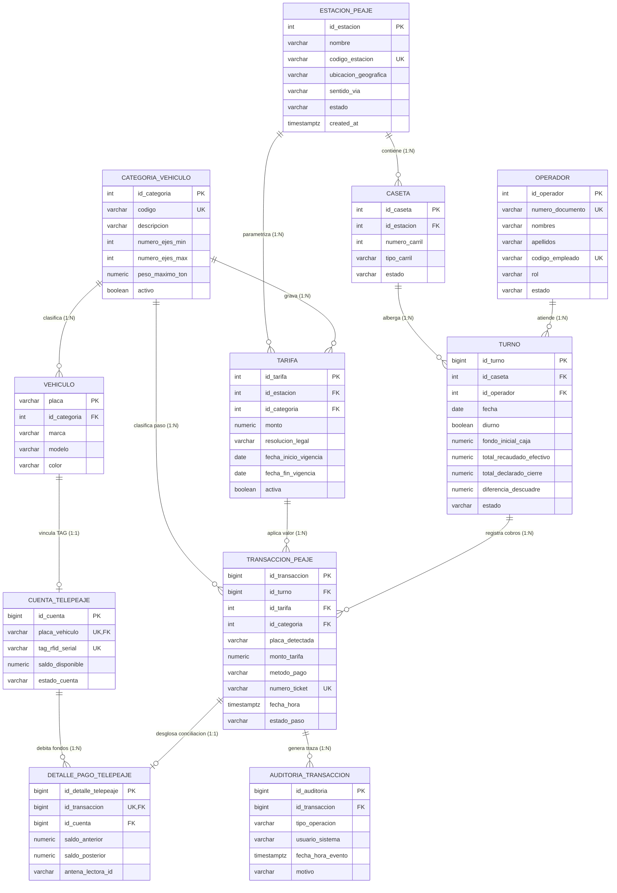

# Especificación del Modelo Relacional y Normalización: PeajeSys
**Asignatura:** Bases de Datos (2026-2) — Universidad de Cartagena  
**Docente:** Víctor Valdelamar  
**Proyecto:** PeajeSys (Sistema Integral de Control, Facturación y Recaudación de Peajes Viales)  
**Equipo:** Camilo Guzmán, Samuel Otero, Alex Flórez, Manuel Amell  

---

## 1. Diagrama Entidad-Relación (DER) en Mermaid

---

## 2. Demostración de Normalización en Tercera Forma Normal (3FN)

El diseño relacional de **PeajeSys** garantiza la ausencia de redundancias, anomalías de inserción, actualización y borrado mediante el cumplimiento riguroso de las formas normales:

### 2.1 Primera Forma Normal (1FN)
* Todos los atributos contienen **valores atómicos e indivisibles**. No existen atributos multivaluados ni vectores compuestos.
* Cada tabla cuenta con una **clave primaria unívoca** (`PK`), asegurando la unicidad de las tuplas.

### 2.2 Segunda Forma Normal (2FN)
* Cumple 1FN.
* Todos los atributos no clave tienen **dependencia funcional completa** de la clave primaria.
* Se resolvió la relación Muchos a Muchos ($N:M$) entre `ESTACION_PEAJE` y `CATEGORIA_VEHICULO` mediante la entidad asociativa `TARIFA`, evitando dependencias parciales sobre claves compuestas.

### 2.3 Tercera Forma Normal (3FN)
* Cumple 2FN.
* No existen **dependencias transitivas** entre atributos no clave ($X \to Y \to Z$).
  - Por ejemplo: En `TRANSACCION_PEAJE`, los datos del cajero o caseta no se repiten en la transacción; se referencia `id_turno`, el cual a su vez enlaza a `CASETA` y `OPERADOR`.
  - En `VEHICULO`, la descripción y límites de ejes no se almacenan en la tupla del vehículo sino en `CATEGORIA_VEHICULO`.
  - En `CUENTA_TELEPEAJE`, los datos técnicos del fabricante automotor no se duplican, referenciando exclusivamente la `placa` enlazada a `VEHICULO`.

---

## 3. Matriz de Cardinalidades y Reglas de Integridad

| Relación | Entidad Origen | Cardinalidad | Entidad Destino | Regla de Integridad Referencial |
| :--- | :--- | :---: | :--- | :--- |
| Infraestructura Carril | `ESTACION_PEAJE` | $1:N$ | `CASETA` | `ON DELETE RESTRICT` (No eliminar estación con casetas) |
| Asignación Operativa | `CASETA` | $1:N$ | `TURNO` | `ON DELETE RESTRICT` (No eliminar casetas con turnos) |
| Responsable de Turno | `OPERADOR` | $1:N$ | `TURNO` | `ON DELETE RESTRICT` (No borrar operadores con histórico) |
| Parametrización Tarifaria | `ESTACION_PEAJE` | $1:N$ | `TARIFA` | `ON DELETE RESTRICT` |
| Clasificación Tarifaria | `CATEGORIA_VEHICULO` | $1:N$ | `TARIFA` | `ON DELETE RESTRICT` |
| Padrón Vehicular | `CATEGORIA_VEHICULO` | $1:N$ | `VEHICULO` | `ON DELETE RESTRICT` |
| Dispositivo RFID | `VEHICULO` | $1:1$ | `CUENTA_TELEPEAJE` | `ON DELETE RESTRICT`, `placa_vehiculo UNIQUE` |
| Cruce en Caseta | `TURNO` | $1:N$ | `TRANSACCION_PEAJE` | `ON DELETE RESTRICT` |
| Base Tarifaria de Paso | `TARIFA` | $1:N$ | `TRANSACCION_PEAJE` | `ON DELETE RESTRICT` |
| Conciliación Débito | `TRANSACCION_PEAJE`| $1:1$ | `DETALLE_PAGO_TELEPEAJE`| `ON DELETE RESTRICT`, `id_transaccion UNIQUE` |
| Saldo Prepago | `CUENTA_TELEPEAJE` | $1:N$ | `DETALLE_PAGO_TELEPEAJE`| `ON DELETE RESTRICT` |
| Pista Forense | `TRANSACCION_PEAJE`| $1:N$ | `AUDITORIA_TRANSACCION` | `ON DELETE RESTRICT`, `Append-Only Trigger` |
