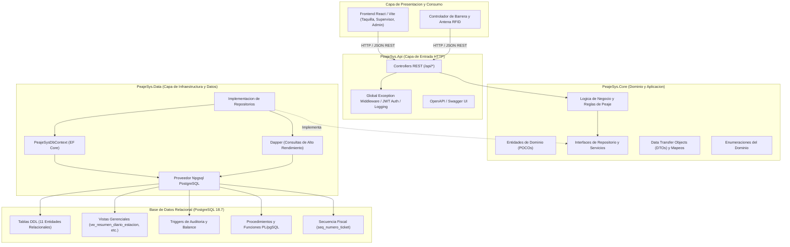
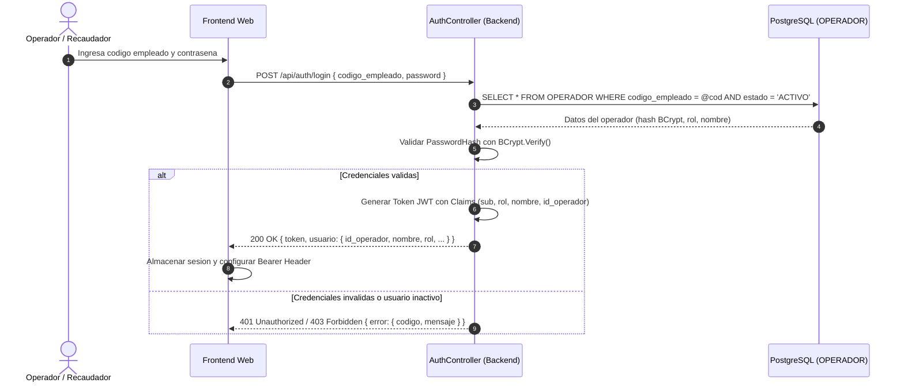

# Arquitectura del Sistema Backend: PeajeSys

Documento de especificación arquitectónica para la solución Web API en C# y .NET (versión 8.0 / 9.0) del sistema de control y recaudo de peajes PeajeSys.

---

## 1. Visión General del Sistema

PeajeSys es una plataforma distribuida de misión crítica orientada al control, recaudo y auditoría vehicular en estaciones de peaje concesionadas. El backend actúa como el núcleo transaccional, garantizando:

1. **Alta disponibilidad y baja latencia**: Procesamiento de transacciones de paso vehicular en caseta en menos de 150 ms por evento.
2. **Consistencia e integridad transaccional (ACID)**: Conciliación estricta de dinero en efectivo recaudado, cobro electrónico RFID (telepeaje) y cierre cuadrado de turnos sin inconsistencias monetarias.
3. **Auditoría continua e inmutabilidad**: Trazabilidad completa de operaciones críticas (aperturas de turno, ajustes tarifarios, discrepancias de arqueo y pasos vehiculares).
4. **Desacoplamiento e interoperabilidad**: Exposición de una API RESTful estandarizada que satisface el [contrato-api-frontend.md](file:///home/amell/orca/workspaces/PeajeSys/peajesys-develop/docs/contrato-api-frontend.md) implementado por la interfaz web React/Vite.

---

## 2. Diagrama General de Arquitectura

El sistema implementa una **Arquitectura en Capas Limpia (Clean / Onion Architecture)** con separación estricta de responsabilidades:



---

## 3. Descomposición de Proyectos y Estructura de la Solución

La solución de Visual Studio `backend/PeajeSys.sln` se estructura en tres proyectos principales más la suite de pruebas:

```text
backend/
├── PeajeSys.sln
├── PeajeSys.Api/                  # Proyecto Web API (Host ejecutable)
│   ├── Controllers/               # Controladores REST organizados por recurso
│   ├── Middlewares/               # Manejo global de excepciones, auditoria HTTP
│   ├── Extensions/                # ServiceCollectionExtensions (DI)
│   ├── appsettings.json           # Configuracion base (cadenas de conexion, JWT)
│   ├── appsettings.Development.json
│   └── Program.cs                 # Punto de entrada, pipeline HTTP y contenedor DI
├── PeajeSys.Core/                 # Nucleo agnostico de infraestructura
│   ├── Entities/                  # Clases de dominio mapeadas al DDL
│   ├── Enums/                     # Rol, EstadoTurno, MetodoPago, TipoCaseta, etc.
│   ├── Interfaces/                # Contratos de repositorios y servicios
│   ├── DTOs/                      # Requests, Responses y Payloads del contrato
│   ├── Exceptions/                # DomainException, NotFoundException, ConflictException
│   └── Services/                  # Servicios de negocio (Cobro, Turno, Arqueo, Tarifa)
├── PeajeSys.Data/                 # Acceso a datos e infraestructura
│   ├── Context/                   # PeajeSysDbContext
│   ├── Configurations/            # Fluent API EntityTypeConfiguration
│   ├── Repositories/              # Implementacion de repositorios
│   └── Migrations/                # Historial de migraciones EF Core
└── PeajeSys.Tests/                # Suite de pruebas automatizadas
    ├── Unit/                      # Pruebas unitarias de servicios y calculos
    └── Integration/               # Pruebas de integracion con Testcontainers
```

---

## 4. Responsabilidades Detalladas por Capa

### 4.1 PeajeSys.Api (Capa de Presentación y Servicios Web)
- **Controladores REST**:
  - `AuthController`: Gestión de sesiones, login por rol, logout y verificación de usuario activo.
  - `EstacionesController`: Catálogo de estaciones y casetas operativas.
  - `OperadoresController`: Administración de personal de peaje y supervisores.
  - `CategoriasController`: Categorías vehiculares oficiales (I a VII) y tarifas base.
  - `TarifasController`: Consulta de tarifas vigentes por estación y actualización con histórico.
  - `VehiculosController`: Validación de placas, consulta de vehículos y saldo de TAG RFID.
  - `TurnosController`: Apertura de turno en caseta, consulta de turnos activos y cierre de turno.
  - `RecaudoController`: Registro atómico de transacción de paso vehicular (efectivo o telepeaje).
  - `AuditoriaController`: Consulta de trazas de eventos del sistema y cambios de estado.
  - `SupervisorController`: Consulta de arqueos, conciliaciones y resumen diario de estación.
- **Middleware Global de Excepciones**:
  - Intercepta excepciones no controladas y las transforma en el formato estándar RFC / PeajeSys:
    ```json
    {
      "error": {
        "codigo": "CODIGO_ERROR",
        "mensaje": "Mensaje legible en espanol.",
        "campos": { "campo": "Detalle de error" }
      }
    }
    ```
- **Filtros y Seguridad**:
  - Autenticación mediante tokens JWT Bearer.
  - Políticas de autorización basadas en Claims de rol: `[Authorize(Roles = "RECAUDADOR,SUPERVISOR,ADMINISTRADOR")]`.
  - Configuración estricta de CORS para admitir el origen del cliente web (`http://localhost:5180` en desarrollo).

### 4.2 PeajeSys.Core (Capa de Dominio y Lógica de Negocio)
- **Entidades de Dominio**:
  - Clases POCO estrictamente alineadas con los tipos de datos de PostgreSQL 18.7:
    - `EstacionPeaje`, `Caseta`, `Operador`, `Turno`, `CategoriaVehiculo`, `Tarifa`, `Vehiculo`, `CuentaTelepeaje`, `TransaccionPeaje`, `DetallePagoTelepeaje`, `AuditoriaTransaccion`.
- **Servicios de Dominio (`Domain Services`)**:
  - `CobroService`:
    - Valida que el turno del operador esté `ABIERTO`.
    - Determina la tarifa vigente exacta según categoría vehicular y estación.
    - Si el pago es en efectivo: valida que `efectivoRecibido >= tarifa`, calcula el cambio exacto.
    - Si el pago es telepeaje: valida que la cuenta esté `ACTIVA`, posea saldo suficiente (`saldo >= tarifa`) y deduce el monto de forma atómica.
    - Genera el número de tiquete fiscal utilizando la secuencia de base de datos `seq_numero_ticket`.
  - `TurnoService`:
    - Control de apertura de turno: valida que el operador no posea ya otro turno abierto y que la caseta no esté ocupada.
    - Control de cierre de turno: consolida el total recaudado en efectivo vs telepeaje.
  - `ArqueoService`:
    - Calcula la discrepancia entre el efectivo reportado en sobre de liquidación y la sumatoria real de transacciones de paso:
      - `diferencia = efectivoReportado - totalRecaudadoEfectivo`.
      - Si `diferencia == 0`: estado `CUADRADO`.
      - Si `diferencia < 0`: estado `FALTANTE`.
      - Si `diferencia > 0`: estado `SOBRANTE`.

### 4.3 PeajeSys.Data (Capa de Persistencia y Acceso a Datos)
- **Entity Framework Core 8/9 + Npgsql**:
  - Mapeo explícito mediante `IEntityTypeConfiguration<T>` utilizando nombres de tabla y columnas en snake_case para compatibilidad total con PostgreSQL.
  - Registro de relaciones, índices únicos y restricciones `CHECK`.
- **Dapper para Consultas de Alto Rendimiento**:
  - En puntos críticos de lectura masiva (monitoreo de auditoría y reporte consolidado de estación `vw_resumen_diario_estacion`), se emplea Dapper para ejecutar consultas SQL directas optimizadas con tiempo de respuesta inferior a 10 ms.
- **Manejo de Transacciones de Base de Datos**:
  - Uso de transacciones `IDbContextTransaction` con nivel de aislamiento `ReadCommitted` o `RepeatableRead` durante el procesamiento del cobro de peaje para evitar lecturas sucias y condiciones de carrera en el débito de saldo RFID.

---

## 5. Integración con Objetos Avanzados de PostgreSQL

El backend se conecta con la base de datos PostgreSQL `peajesys_db` e interactúa con sus objetos avanzados:

| Objeto en BD | Tipo | Uso en el Backend |
|---|---|---|
| `seq_numero_ticket` | Secuencia | Generación concurrente y segura del número de tiquete fiscal consecutivo (`TCK-YYYYMMDD-XXXXX`). |
| `idx_transaccion_fecha_turno` | Índice B-Tree | Optimización de consultas de arqueo y filtrado de transacciones por rango de fecha y turno. |
| `vw_resumen_diario_estacion` | Vista | Mapeada a la entidad `ResumenDiarioEstacion` en EF Core para alimentar el dashboard gerencial del supervisor. |
| `vw_estado_cuentas_telepeaje` | Vista | Mapeada a `EstadoCuentaTelepeaje` para consulta de saldos críticos y cuentas bloqueadas. |
| Procedimientos / Triggers | PL/pgSQL | Ejecución delegada de auditorías automáticas de actualización de saldo y validaciones de regla de negocio. |

---

## 6. Políticas de Seguridad y Autenticación



- **Algoritmo de Hashing**: BCrypt con factor de costo 12 (o Argon2id).
- **Claims incluidos en el Token JWT**:
  - `sub`: Identificador único del operador (`id_operador`).
  - `name`: Nombre y apellidos completos del empleado.
  - `role`: Rol funcional (`RECAUDADOR`, `SUPERVISOR`, `ADMINISTRADOR`).
  - `codigo`: Código institucional (ej. `EMP-002`, `ADM-001`).
  - `exp`: Tiempo de expiración (8 horas, correspondiente a la jornada de turno de peaje).

---

## 7. Estrategia de Resiliencia y Concurrencia

1. **Concurrencia en Caseta de Peaje**:
   - Cada caseta opera de forma autónoma con un único turno abierto a la vez. La base de datos garantiza mediante una restricción de índice condicional que no existan dos turnos con `estado = 'ABIERTO'` simultáneamente en la misma caseta.
2. **Bloqueo Pesimista en Cobro de Telepeaje**:
   - Para evitar que un mismo vehículo o TAG RFID sea debitado concurrentemente en casetas paralelas si pasa en rápida sucesión, la actualización del saldo en `CUENTA_TELEPEAJE` utiliza una consulta con bloqueo de fila:
     `SELECT saldo_disponible FROM CUENTA_TELEPEAJE WHERE placa_vehiculo = @placa FOR UPDATE;`
3. **Resiliencia de Conexión**:
   - Configuración de reintentos automáticos ante fallas transitorias de red con `EnableRetryOnFailure` de Npgsql (máximo 3 reintentos con retardo exponencial).

---

## 8. Documentos Relacionados
- [design.md](file:///home/amell/orca/workspaces/PeajeSys/peajesys-develop/docs/design.md): Diseño detallado de componentes y flujos de datos.
- [stack-backend.md](file:///home/amell/orca/workspaces/PeajeSys/peajesys-develop/docs/stack-backend.md): Matriz de versiones y dependencias tecnológicas.
- [contrato-api-frontend.md](file:///home/amell/orca/workspaces/PeajeSys/peajesys-develop/docs/contrato-api-frontend.md): Especificación de los 24 endpoints REST.
- [TAREA-BACKEND-GENERAL.md](file:///home/amell/orca/workspaces/PeajeSys/peajesys-develop/docs/backend/TAREA-BACKEND-GENERAL.md): Hoja de ruta y plan de tareas para Alex y Samuel.
