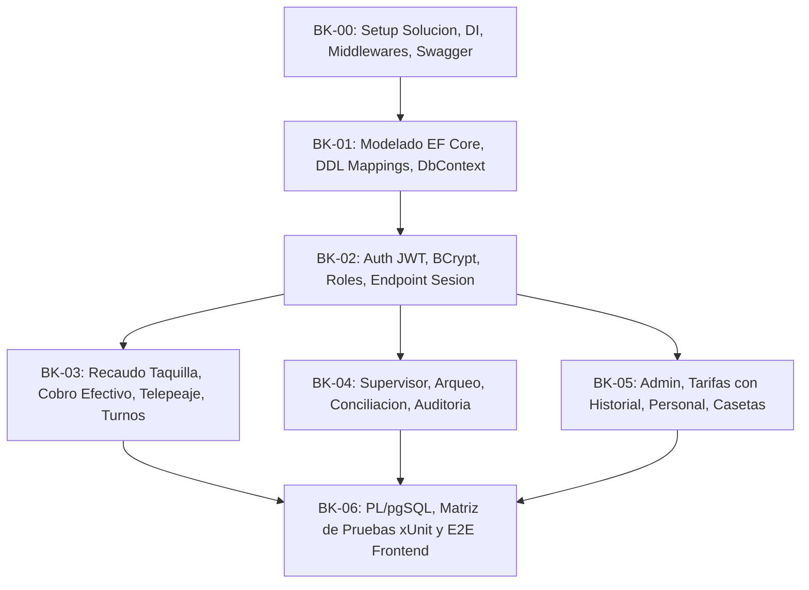

# TAREA MAESTRA: DESARROLLO DEL BACKEND PEAJESYS (C# .NET)

Documento de especificación general y hoja de ruta para el equipo de desarrollo del backend de PeajeSys.

---

## 1. Objetivo y Alcance

Construir la solución Web API en C# y .NET (versión 8.0 LTS o 9.0) para el Sistema de Control y Recaudo de Peajes PeajeSys, garantizando:
1. Implementación fiel del [contrato-api-frontend.md](../contrato-api-frontend.md) (24 endpoints REST).
2. Persistencia relacional íntegra sobre PostgreSQL 18.7 (`peajesys_db`), interactuando con las 11 tablas DDL, vistas analíticas, secuencias fiscales y objetos PL/pgSQL.
3. Cobertura de pruebas unitarias y de integración superior al 80% con xUnit.
4. Concurrencia segura y transaccionalidad ACID en los procesos de cobro en caseta y conciliación de turnos.

---

## 2. Reparto de Trabajo por Desarrollador

| Bloque | Nombre del Bloque | Responsable Principal | Apoyo / Revisor | Archivo de Especificación |
|---|---|---|---|---|
| **BK-00** | Solución Base, Middlewares, Inyección de Dependencias y Swagger | **Alex Florez** | Samuel Otero | [TAREA-BK-00-SETUP.md](./TAREA-BK-00-SETUP.md) |
| **BK-01** | Modelado EF Core, Entidades, Mapeos DDL y Repositorios | **Samuel Otero** | Manuel Amell | [TAREA-BK-01-DATOS.md](./TAREA-BK-01-DATOS.md) |
| **BK-02** | Autenticación JWT, Hashing BCrypt, Roles y Contexto de Sesión | **Alex Florez** | Samuel Otero | [TAREA-BK-02-AUTH.md](./TAREA-BK-02-AUTH.md) |
| **BK-03** | Módulo de Cobro en Taquilla, Telepeaje RFID, Tiquetes y Turnos | **Samuel Otero** | Alex Florez | [TAREA-BK-03-COBRO.md](./TAREA-BK-03-COBRO.md) |
| **BK-04** | Módulo de Supervisor (Arqueo, Conciliación, Auditoría y Vistas) | **Alex Florez** | Manuel Amell | [TAREA-BK-04-SUPERVISOR.md](./TAREA-BK-04-SUPERVISOR.md) |
| **BK-05** | Módulo de Administrador (Tarifas con Vigencia, Personal, Casetas) | **Samuel Otero** | Alex Florez | [TAREA-BK-05-ADMIN.md](./TAREA-BK-05-ADMIN.md) |
| **BK-06** | Integración PL/pgSQL, Matriz de Pruebas xUnit y Validación E2E | **Alex y Samuel** | Manuel Amell | [TAREA-BK-06-PLPGSQL-TESTS.md](./TAREA-BK-06-PLPGSQL-TESTS.md) |

---

## 3. Fases y Orden de Ejecución

---

## 4. Estándares Técnicos y Definición de Terminado (DoD)

Para que un bloque o tarea se considere **TERMINADO (Done)**, debe cumplir:
1. **Compilación Limpia**: `dotnet build` compila con 0 errores y 0 advertencias.
2. **Pruebas Automatizadas**: Pruebas unitarias escritas con xUnit y FluentAssertions; cobertura de código igual o superior al 80%.
3. **Fidelidad al Contrato**: Los endpoints implementados responden exactamente con los códigos HTTP, rutas y formato JSON (snake_case) estipulados en `contrato-api-frontend.md`.
4. **Manejo Controlado de Excepciones**: No se escapan excepciones no capturadas al cliente; los errores devuelven la estructura `{ "error": { "codigo", "mensaje", "campos" } }`.
5. **Cero Rayas Largas**: Prohibido el uso del caracter raya larga (guion largo em-dash) en comentarios, mensajes de error y documentacion.
6. **Integridad de Base de Datos**: Mapeo estricto contra el esquema PostgreSQL existente en `database/02_SQL/01_DDL_PeajeSys.sql` sin renombrar columnas o tablas.

---

## 5. Documentos de Referencia Obligatoria
- [architecture.md](../architecture.md): Arquitectura detallada del backend.
- [design.md](../design.md): Diseño de componentes y flujos.
- [contrato-api-frontend.md](../contrato-api-frontend.md): Contrato técnico de integración API REST.
- [stack-backend.md](../stack-backend.md): Paquetes y convenciones técnicas.
