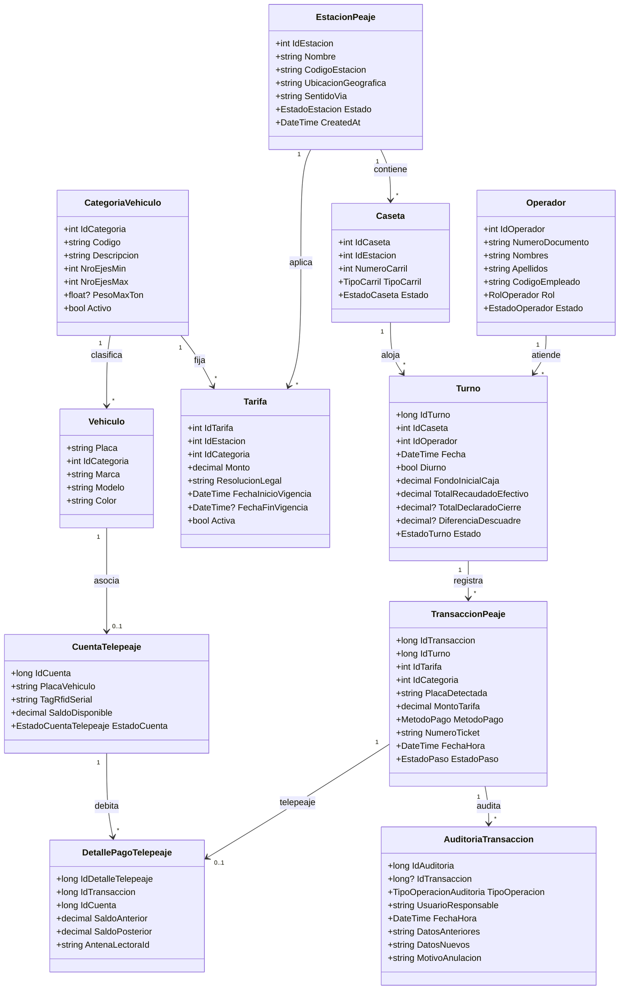
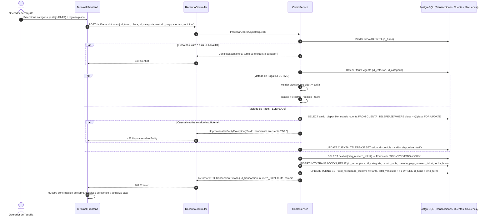
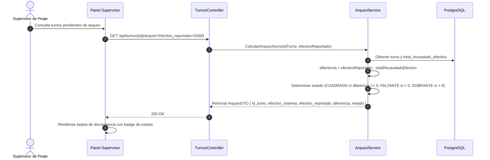

# Diseño del Sistema Backend: PeajeSys

Documento de diseño detallado de componentes, modelos de datos, flujos de negocio y mapeo de endpoints para la Web API en C# y .NET de PeajeSys.

---

## 1. Modelo de Dominio y Entidades

El modelo de dominio traduce fielmente el esquema relacional de PostgreSQL (`database/02_SQL/01_DDL_PeajeSys.sql`) a clases de entidad en `PeajeSys.Core.Entities`.



---

## 2. Enumeraciones del Dominio

Para garantizar consistencia y tipado estricto, se definen los siguientes enums en `PeajeSys.Core.Enums`:

```csharp
namespace PeajeSys.Core.Enums
{
    public enum EstadoEstacion
    {
        ACTIVA,
        INACTIVA,
        MANTENIMIENTO
    }

    public enum TipoCarril
    {
        MANUAL,
        TELEPEAJE_EXCLUSIVO,
        MIXTO
    }

    public enum EstadoCaseta
    {
        OPERATIVA,
        CERRADA,
        MANTENIMIENTO
    }

    public enum RolOperador
    {
        RECAUDADOR,
        SUPERVISOR
    }

    public enum EstadoOperador
    {
        ACTIVO,
        INACTIVO
    }

    public enum EstadoTurno
    {
        ABIERTO,
        CERRADO
    }

    public enum EstadoCuentaTelepeaje
    {
        ACTIVA,
        SUSPENDIDA
    }

    public enum MetodoPago
    {
        EFECTIVO,
        TELEPEAJE,
        EXENTO
    }

    public enum EstadoPaso
    {
        APROBADO,
        EVASION,
        EXENTO
    }

    public enum TipoOperacionAuditoria
    {
        INSERT,
        UPDATE,
        VOID
    }

    public enum TipoDiscrepancia
    {
        CUADRADO,
        FALTANTE,
        SOBRANTE
    }
}
```

---

## 3. Mapeo Integral de Endpoints REST (Contrato de API)

La API implementa con exactitud los 24 endpoints definidos en el [contrato-api-frontend.md](./contrato-api-frontend.md):

### 3.1 Módulo de Autenticación (`/api/auth`)
| Método | Ruta | Controlador / Acción | Rol Requerido | Descripción |
|---|---|---|---|---|
| `POST` | `/api/auth/login` | `AuthController.Login` | Público | Autentica por código de empleado y contraseña; retorna JWT y usuario. |
| `POST` | `/api/auth/logout` | `AuthController.Logout` | Autenticado | Invalida el token o sesión activa del operador. |
| `GET` | `/api/auth/sesion` | `AuthController.ObtenerSesion` | Autenticado | Devuelve el perfil del operador actualmente autenticado. |

### 3.2 Módulo de Estaciones y Casetas (`/api/estaciones`, `/api/casetas`)
| Método | Ruta | Controlador / Acción | Rol Requerido | Descripción |
|---|---|---|---|---|
| `GET` | `/api/estaciones` | `EstacionesController.ListarEstaciones` | Autenticado | Retorna el catálogo completo de estaciones de peaje. |
| `GET` | `/api/estaciones/{id}` | `EstacionesController.ObtenerPorId` | Autenticado | Detalle de una estación y sus casetas asociadas. |
| `GET` | `/api/casetas` | `CasetasController.ListarCasetas` | Autenticado | Listado de casetas filtrables por estación y estado. |
| `PATCH` | `/api/casetas/{id}/estado` | `CasetasController.CambiarEstado` | `ADMINISTRADOR`, `SUPERVISOR` | Actualiza estado (OPERATIVA, CERRADA, MANTENIMIENTO). |

### 3.3 Módulo de Operadores y Personal (`/api/operadores`)
| Método | Ruta | Controlador / Acción | Rol Requerido | Descripción |
|---|---|---|---|---|
| `GET` | `/api/operadores` | `OperadoresController.ListarOperadores` | `ADMINISTRADOR`, `SUPERVISOR` | Catálogo de empleados con filtro por rol y estado. |
| `GET` | `/api/operadores/{id}` | `OperadoresController.ObtenerPorId` | `ADMINISTRADOR`, `SUPERVISOR` | Ficha técnica del operador y su historial de turnos. |
| `POST` | `/api/operadores` | `OperadoresController.CrearOperador` | `ADMINISTRADOR` | Registra un nuevo empleado en el sistema. |
| `PATCH` | `/api/operadores/{id}/estado` | `OperadoresController.CambiarEstado` | `ADMINISTRADOR` | Modifica estado de cuenta (ACTIVO o INACTIVO). |

### 3.4 Módulo de Categorías y Tarifas (`/api/categorias`, `/api/tarifas`)
| Método | Ruta | Controlador / Acción | Rol Requerido | Descripción |
|---|---|---|---|---|
| `GET` | `/api/categorias` | `CategoriasController.ListarCategorias` | Autenticado | Retorna las categorías oficiales (I a VII) y número de ejes. |
| `GET` | `/api/tarifas` | `TarifasController.ListarTarifas` | Autenticado | Tarifas vigentes o históricas por estación y categoría. |
| `GET` | `/api/tarifas/vigente` | `TarifasController.ObtenerVigente` | Autenticado | Consulta la tarifa activa para una estación y categoría dadas. |
| `POST` | `/api/tarifas` | `TarifasController.CrearTarifa` | `ADMINISTRADOR` | Crea una tarifa cerrando la vigencia de la anterior de forma atómica. |

### 3.5 Módulo de Vehículos y Telepeaje (`/api/vehiculos`, `/api/telepeaje`)
| Método | Ruta | Controlador / Acción | Rol Requerido | Descripción |
|---|---|---|---|---|
| `GET` | `/api/vehiculos/{placa}` | `VehiculosController.ConsultarPlaca` | Autenticado | Consulta placa, categoría predeterminada y estado de cuenta TAG. |
| `GET` | `/api/telepeaje/cuentas` | `TelepeajeController.ListarCuentas` | `SUPERVISOR`, `ADMINISTRADOR` | Consulta de cuentas RFID, saldos y diagnóstico (vista BD). |
| `POST` | `/api/telepeaje/recargar` | `TelepeajeController.RecargarSaldo` | `SUPERVISOR`, `ADMINISTRADOR` | Recarga saldo a cuenta de telepeaje vinculada a una placa. |

### 3.6 Módulo de Turnos y Cierre (`/api/turnos`)
| Método | Ruta | Controlador / Acción | Rol Requerido | Descripción |
|---|---|---|---|---|
| `GET` | `/api/turnos` | `TurnosController.ListarTurnos` | Autenticado | Lista turnos con filtros por estado, fecha, caseta u operador. |
| `GET` | `/api/turnos/{id}` | `TurnosController.ObtenerPorId` | Autenticado | Detalle completo de un turno, recaudos y conteo de vehículos. |
| `POST` | `/api/turnos/abrir` | `TurnosController.AbrirTurno` | `RECAUDADOR`, `SUPERVISOR` | Apertura de turno validando exclusividad de caseta y operador. |
| `POST` | `/api/turnos/{id}/cerrar` | `TurnosController.CerrarTurno` | `RECAUDADOR`, `SUPERVISOR` | Cierra el turno consolidando totales y registrando fecha de fin. |
| `GET` | `/api/turnos/{id}/arqueo` | `TurnosController.ObtenerArqueo` | `SUPERVISOR` | Cálculo de conciliación, diferencia y estado de arqueo. |

### 3.7 Módulo de Recaudo y Auditoría (`/api/recaudo`, `/api/auditoria`)
| Método | Ruta | Controlador / Acción | Rol Requerido | Descripción |
|---|---|---|---|---|
| `POST` | `/api/recaudo/cobro` | `RecaudoController.RegistrarCobro` | `RECAUDADOR` | Registro atómico de transacción de peaje, tiquete y cambio. |
| `GET` | `/api/recaudo/diario` | `RecaudoController.ObtenerResumenDiario` | `SUPERVISOR`, `ADMINISTRADOR` | Consulta de la vista `vw_resumen_diario_estacion`. |
| `GET` | `/api/auditoria` | `AuditoriaController.ListarEventos` | `SUPERVISOR`, `ADMINISTRADOR` | Trazas de auditoría con filtros por fecha, acción y responsable. |

---

## 4. Flujos Transaccionales Detallados

### 4.1 Flujo de Cobro de Peaje en Taquilla (Efectivo y Telepeaje)



### 4.2 Flujo de Cierre de Turno y Arqueo del Supervisor



---

## 5. Esquema de Manejo de Errores y Validaciones

Las validaciones se ejecutan en dos niveles:
1. **Validación de Entrada (FluentValidation)**: Comprobación de formato de placas (`^[A-Z]{3}[0-9]{3}$`), montos positivos, campos requeridos.
2. **Validaciones de Regla de Negocio (Domain Exceptions)**: Lanzadas en la capa de servicios y capturadas por el `ExceptionMiddleware` para retornar respuestas estandarizadas:

```json
{
  "error": {
    "codigo": "SALDO_INSUFICIENTE",
    "mensaje": "La cuenta de telepeaje asociada a la placa no cuenta con saldo suficiente.",
    "campos": {
      "placa": "Saldo disponible: $ 15.000 COP, Tarifa requerida: $ 21.000 COP"
    }
  }
}
```

---

## 6. Documentos Relacionados
- [architecture.md](./architecture.md): Arquitectura en capas y componentes del sistema.
- [contrato-api-frontend.md](./contrato-api-frontend.md): Contrato técnico oficial de endpoints y payloads.
- [TAREA-BACKEND-GENERAL.md](./backend/TAREA-BACKEND-GENERAL.md): Tareas de desarrollo para Alex y Samuel.
